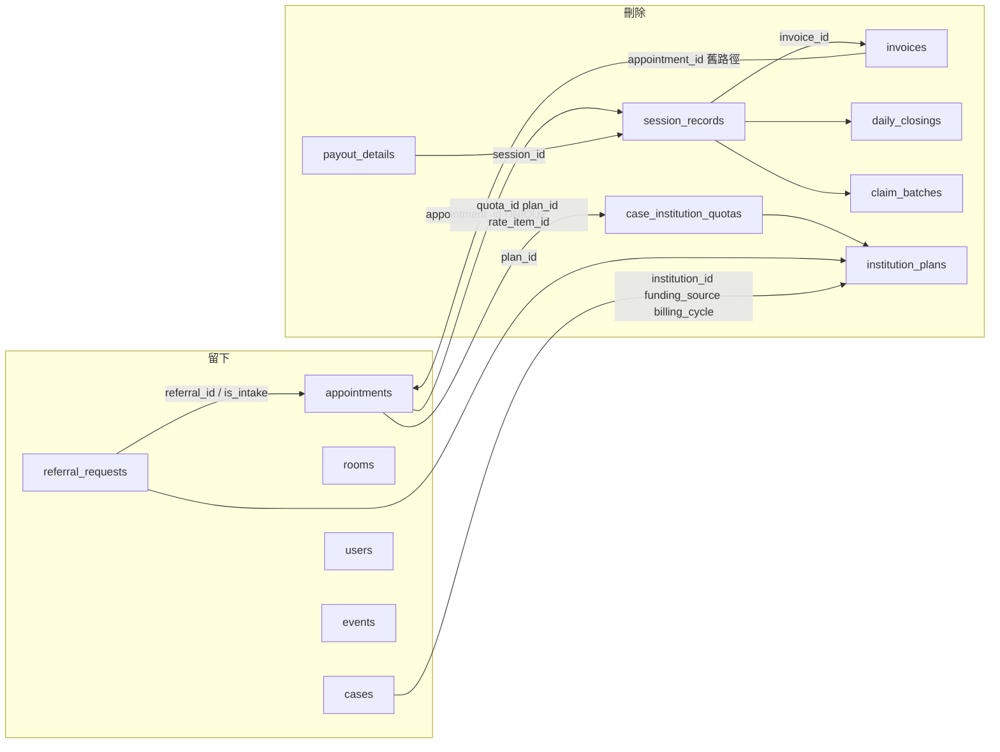
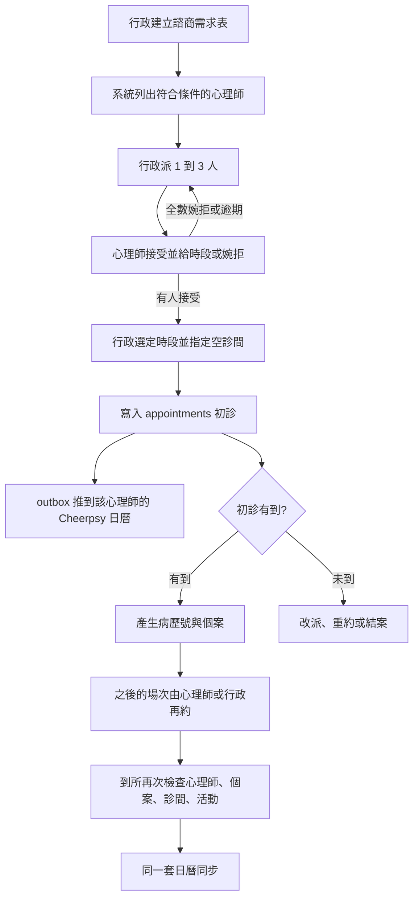

# Cheerpsy 重構計畫：拿掉帳務、把預約收斂到媒合與診間

日期：2026-11-16（定位更新：2026-11-17）  
範圍：只做調查與計畫。本文件不改應用程式碼、不開 pull request。  
對象程式庫：`/workspace`（CheerPsy v2，FastAPI + Next.js 14）。  
Alembic HEAD：`zg7c1d2e3f4c`（`apps/api/alembic/versions/zg7c1d2e3f4c_phase9_claim_rules.py`）。

這份計畫對準現在這份程式，不是一份通用診所系統草圖。帳務不是旁邊一顆模組：報到當下就會寫流水帳，預約 API 的回應裡直接算出心理師分潤與診所分潤，診間日曆的「收款」打的是財務 API。媒合、診間、單向 iCal 已經有骨架，但屬性媒合、心理師時段衝突、活動與預約的雙向佔用、以及真正的 Google 日曆同步都還沒有。

舊規格（`document_reference/cheerpsy_v7_spec_extracted.md`、`gap_analysis.md`、`open_questions.md`）把「報到 → 收款 → 收據 → 核銷 → 酬勞」當成主流程。本次業主要求與那套規格相反：帳務整包拿掉，預約以媒合為中心，並補上診間安排與 Google 日曆。實作時以本次業主決定為準，舊規格裡的帳務定案（收據檢核碼、70/30、核銷狀態機、失約費 $200/$500）不再實作。

> **系統定位（2026-11-17 定案，優先於本文件其他段落）**
> 本系統管理**預約、媒合、診間／場地空間與行事曆**，並**詳細呈現金額與經費來源**；**不對金流負責**——收款、對帳在行政另一套系統。
> 舊版（`origin/docs/operational-system-framework-en`）為了金流對齊設計得很嚴謹，現在不需要，只當參考。
>
> - **要做／已做**：金額必填且 > 0（借場地方案以 `institution_plans.allows_zero_amount` 例外），可編輯，改了同步 Google 標題；預約、詳情、列表清楚顯示自費／機構、機構名、方案、價目項目、總額、自付額、機構補助（`amount − self_pay_amount`，算出來不存）、交通費、剩餘堂數，自付額為 NULL 顯示「未設定」；計價正確（`consult_type`、`service_type` 真的帶入價目挑選、「第幾次」依預約日期、改時長時未手動調整的金額重新計價並回 `warnings`）；舊預約自付額回填（先 `session_records`，再價目項目，都沒有才 NULL）；唯讀檢查腳本 `apps/api/scripts/check_amounts.py`；額度只顯示剩餘堂數、不擋預約。
> - **停用（欄位保留不刪）**：收款記錄（`payment_status`／方式／時間／經手人、`/collection` 端點與頁面）；失約費建議金額與設定頁。端點回 410，前端入口移除。
> - **不做**：折扣、轉帳後五碼、月結、額度池（堂數／金額）、伴侶付費方分攤。
> - Google 標題金額：自費「$全額」；機構「$總額（自付 $X）」，全額補助「$總額（機構全額）」，自付額未知「$總額（自付未設定）」。
> - 心理師隔離規則不變：心理師只看得到自己個案的方案、額度與金額（別人的 404）。

---

## 1. 現況架構

### 1.1 技術棧與部署

| 層 | 實作 | 位置 |
|---|---|---|
| 前端 | Next.js 14 App Router、TypeScript、Tailwind、NextAuth v5 beta（`next-auth@5.0.0-beta.25`）、FullCalendar 6、Chart.js | `apps/web/` |
| 後端 | FastAPI 0.115、SQLAlchemy 2.0、Alembic、Pydantic Settings、python-jose JWT、bcrypt、ReportLab、openpyxl | `apps/api/` |
| 資料庫 | PostgreSQL 16。預約時間用 `tstzrange` | `docker-compose.yml` |
| 快取 | Redis 7 只在 compose 裡。`apps/api` 沒有任何 `redis` / Celery / APScheduler 引用 | `docker-compose.yml`、`docker-compose.prod.yml` |
| 認證 | API：Bearer JWT，角色以資料庫 `users.role` 為準（`apps/api/app/auth/dependencies.py` 的 `RequireRole`）。Web：Credentials provider 打 `POST /auth/login` 再打 `GET /auth/me`（`apps/web/src/lib/auth.ts`） | |
| 測試 | 整個 repo 沒有 pytest / 前端測試檔 | |
| 背景工作 | 沒有。結算與派案逾期都是「有人打 API 時順便做」 | `settlement.py`、`referrals.py` 的 `sweep_expired` |

部署有兩條：

- Railway：`RAILWAY_DEPLOY.md`。API 與 Web 分開。
- Windows / 自建：`WINDOWS_DEPLOY.md`、`docker-compose.prod.yml`、`deploy.ps1`、`start-cheerpsy.bat`。

`apps/api/Dockerfile` 的啟動指令是 `alembic upgrade head && uvicorn ...`。任何 DROP TABLE 的 migration 會在下次部署時自動跑完，沒有人工閘門。帳務表刪除必須拆成「先停寫入」與「再 drop」兩次上線，中間先做匯出。詳見 §3.4。

環境變數（現有，沒有 Google 相關）：

- API（`apps/api/app/config.py`）：`DATABASE_URL`、`JWT_SECRET`、`JWT_ALGORITHM`、`JWT_EXPIRE_MINUTES`、`ID_ENCRYPTION_KEY`、`CORS_ORIGINS`、`OUTPATIENT_MIN_FEE`（預設 1000，只服務外出諮商保底抽成）。
- 正式 compose 另有 `CLAIM_DOC_ROOT`（核銷附件，volume `claimdocs`）。
- Web：`NEXT_PUBLIC_API_URL`、`API_URL`、`NEXTAUTH_SECRET`、`NEXTAUTH_URL`、`AUTH_TRUST_HOST`。範本在 `.env.production.example`。

`OUTPATIENT_MIN_FEE` 與 `CLAIM_DOC_ROOT` 只服務帳務，刪帳務後可移除。

### 1.2 目錄（與本次有關的部分）

```
apps/api/app/main.py              30 個 router，無全域 prefix
apps/api/app/models/              27 個 model 檔
apps/api/app/routers/             預約、媒合、帳務、核銷、報表
apps/api/app/services/            settlement、quota_flow、claim_*、pdf、plan_pricing、receipt_number
apps/api/app/auth/                JWT + RequireRole
apps/api/alembic/versions/        44 個 migration，HEAD zg7c1d2e3f4c
apps/api/seed.py                  1 admin + 1 accountant + 17 心理師 + 13 間診間
apps/web/src/lib/nav.ts           行政 / 心理師兩套側邊欄
apps/web/src/app/(app)/           行政頁（帳務頁也在這裡）
apps/web/src/app/(therapist)/     心理師專屬頁
apps/web/src/middleware.ts        只檢查有沒有登入，不檢查角色
document_reference/               v7 規格、落差盤點、未決問題（帳務導向）
```

### 1.3 角色（現在只有四種字串）

存在 `users.role`（`apps/api/app/models/user.py` 第 14 行註解），不是 Postgres enum：

| 值 | 介面標籤（`nav.ts` 的 `ROLE_LABEL`） | 實際能做的事 |
|---|---|---|
| `admin` | 管理員 | 使用者、邀請、機構主檔、匯入匯出、解鎖帳、觸發結算、看全部營運頁。也可進入心理師 route group |
| `accountant` | 會計 | 財務、核銷送出/入帳、報表。**不能建立預約**（`appointments.py` 建立端點內直接擋）。可以報到、建媒合 |
| `staff` | 櫃台行政 | 預約、改期、媒合、活動、結案、大部分流水操作。看不到「數據分析」「系統管理」 |
| `therapist` | 心理師 | 只看自己的個案與預約、回派案、iCal token。名單制心理師 `has_account=false` 可被派案與預約，但不能登入 |

沒有 `manager`。主管該做的事（看全所日曆、改派、覆核例外）目前全部堆在 `admin` 上，而 `admin` 同時又是系統管理員。

前端權限很鬆：`apps/web/src/middleware.ts` 只擋未登入。財務 URL 打得出來，只是側邊欄不顯示。心理師 layout（`apps/web/src/app/(therapist)/layout.tsx`）只擋 `accountant` 與 `staff`，`admin` 進得去。登入成功一律 `router.push("/dashboard")`（`apps/web/src/app/login/page.tsx`），心理師不會落到 `landingForRole` 的 `/today`。

個案姓名可見性在 `appointments.py` 的 `_to_response`：`admin` 與 `staff` 看得到，心理師只看自己的，**會計看不到姓名**。這條規則在拿掉會計之後要改寫，把新的主管角色加進去。

### 1.4 資料模型（預約側 vs 帳務側）

預約與媒合（留下並加強）：

| 表 | Model | 角色 |
|---|---|---|
| `users` | `user.py` | 帳號。帳務欄位：`commission_rate`、`base_price`。日曆欄位：`ical_token`。名單制：`has_account` |
| `cases` | `case.py` | 病歷。已有主訴、諮商型態、派案碼、`referral_id`、結案。帳務欄位：`billing_cycle`、`funding_source`、`institution_id` |
| `case_members` | `couple_member.py` | 伴侶／團體成員 |
| `rooms` | `room.py` | 診間。`room_type` 預設 `talk`（註解寫 2C、2E 為 `play`）。沒有 `is_active` |
| `appointments` | `appointment.py` | 預約本體。`time_range tstzrange`，`room_id` 可空，狀態 `booked/executed/cancelled/no_show`，報到 `pending/arrived/absent`。帳務欄位見下方耦合表 |
| `referral_*` 五張表 | `referral.py` | 媒合狀態機已完整，見 §4 |
| `therapist_availability` | `availability.py` | 每週粗時段：`morning/afternoon/evening`。API 有，前端沒有畫面 |
| `events` | `event.py` | 講座／借場地，含場佈時間。講師費欄位已建但註解寫明不進月報 |
| `holidays` | `holiday.py` | 批次預約提示用，不自動跳過 |
| `reminder_log` | `reminder_log.py` | 電訪結果，掛在預約上 |
| `invitations` | `invitation.py` | 開通帳號／重設密碼。與派案邀請無關 |
| `notifications` | `notification.py` | 有表。**沒有被 `models/__init__.py` export** |
| `audit_log` | `audit_log.py` | `table_name` 是字串，沒有 FK。刪表後舊列可以留著 |

帳務與機構請款（刪除對象）：

| 表 | Model | 為什麼算帳務 |
|---|---|---|
| `session_records` | `session_record.py` | 諮商流水。`appointment_id` unique，一筆預約對一筆帳 |
| `invoices` | `invoice.py` | 收據。可掛預約、流水或商品，三者擇一 |
| `daily_closings` / `monthly_reports` / `supervisor_reviews` | `finance.py` | 日結、月報、解鎖覆核 |
| `therapist_payouts` / `payout_details` | `therapist_payout.py` | 酬勞。明細 FK 到 `session_records.id` |
| `petty_cash` | `petty_cash.py` | 零用金。沒有 FK 到預約 |
| `product_sales` | `product_sales.py` | 商品販售 |
| `claim_batches` / `claim_batch_plans` / `claim_documents` | `claim_batch.py`、`claim_extra.py` | 機構核銷 |
| `institutions` / `institution_contracts` / `institution_plans` / `plan_rate_items` / `plan_transport_fees` | `institution*.py` | 合約、價目、交通費、請款時數、回扣 |
| `case_institution_quotas` / `quota_templates` | 對應 model | 額度三態 `used+booked+reserved=total`，DB CHECK 在 migration `z3b1c2d3e4f5` |

機構這疊要不要整包刪，是這次唯一會影響「還能不能排機構轉介個案」的決定，見 §3.2 與 §10。預設建議：**請款、價目、收據、酬勞整包刪；機構名稱若診所仍要標「這案是哪個單位轉來的」就留一張薄的 `institutions` 名冊，額度三態不要留。**

### 1.5 預約現在怎麼跑

建立（`appointments.py` `create_appointment`）：

1. 會計角色直接 403。
2. 心理師只能約自己的個案。
3. `session_type=in_person` 必填 `room_id`。線上／外展不佔診間。
4. `_check_room_conflict`：同一 `room_id`、`status != 'cancelled'`、`time_range && 新時段` 就 409。**`no_show` 也算佔用**，未到之後同一格補不進別人。
5. **不檢查心理師自己有沒有另一場**（線上＋到所可以疊在同一時段）。
6. **不檢查 `events`**。活動建立會擋預約（`events.py` `_check_conflict`），預約建立不會擋活動。方向不對稱。
7. 機構案走 `quota_flow.reserve_to_booked`。
8. **建立當下不寫 `session_records`。**

報到（`PUT /appointments/{id}/arrive`，角色 `admin/staff/accountant`）：

- 狀態改 `executed`，額度 `booked_to_used`。
- **立刻呼叫 `settlement.materialize_appointment`，寫出一筆 `payment_status=unpaid` 的流水。** 這是預約與帳務的主耦合點（`appointments.py` 約第 712 行）。

未到（`PUT /appointments/{id}/absent`）：

- 狀態 `no_show`，失約費寫死：`advance_notice=0`、`late_cancel=200`、`no_notice=500`（`NO_SHOW_FEES`）。
- 額度退回。不寫流水。

另外一條隱形結算：打開幾乎任何 `/ledger` 列表都會呼叫 `materialize_due_appointments`（`ledger.py`）。結束時間減 20 分鐘（`SETTLEMENT_LEAD_MINUTES`）已過、還是 `booked` 的預約，會被改成 `executed` 並生出流水。視訊／外展沒到櫃檯也會被自動當成已到。`POST /ledger/settle` 是同一支函式的手動入口。

取消：結束前 20 分鐘內不可取消；取消把額度從 booked 退回 reserved。不改流水（因為正常取消時流水還不存在）。若流水已存在，刪除預約會被 `_can_delete` 擋下。

媒合轉初診（`referrals.py` `convert_to_appointment`）：建立 `is_intake=true`、`case_id` 可空、必有 `referral_id` 的預約，有診間衝突檢查，**不扣額度**。初診有到（`intake_arrived`）才產生 `cases` 與病歷號。

診間主檔：`GET /rooms` 唯讀（`rooms.py`）。沒有新增／停用 API。種子資料在 `seed.py`，與 v7 規格不一致，見 §5.1。

日曆：`POST /me/ical-token`（僅心理師）與公開 `GET /calendar/{token}.ics`（`events.py` 第 238–302 行）。沒有 OAuth、沒有 Google client library。前端完全沒呼叫這兩個端點（`apps/web` 搜不到 `ical-token` 或 `/me/availability`）。

### 1.6 帳務現在怎麼跑（刪除時要對上的入口）

- 流水、收款、鎖定、折扣、作廢、拆帳、外出補貼：`routers/ledger.py`。
- 日結、應收、月報：`routers/finance_daily.py`。
- 收據編號與 PDF：`services/receipt_number.py`、`services/pdf/`、`routers/receipts.py`、`routers/invoices.py`。
- 核銷：`routers/claim_batches.py`、`routers/claims_extra.py`、`services/claim_batch.py`、`services/claim_rules.py`。
- 酬勞：`routers/payouts.py`、心理師 `GET /me/payout`（`therapist_portal.py`）。
- 零用金、商品：`routers/petty_cash.py`、`routers/product_sales.py`。
- 方案定價：`services/plan_pricing.py`、`routers/institution_plans.py`、`routers/institution_contracts.py`。
- 儀表板營收與未收：`routers/dashboard.py` 直接加總 `session_records`，並讀 `petty_cash`。
- 匯出：`routers/export.py`。匯入：`routers/data_import.py`、`import_excel.py`（會寫流水狀態，含文件裡點名的非法值 `pending_claim`）。

### 1.7 前端地圖

導覽定義只在 `apps/web/src/lib/nav.ts`。

行政 `ADMIN_NAV`：營運總覽、媒合管理、個案管理、診間日曆、預約作業、預約總表、機構合約、機構方案、機構核銷、日報表、應收、月報表、數據分析（admin/accountant）、商品販售、財務管理、系統管理（admin）、個人設定、操作指南。

心理師 `THERAPIST_NAV`：我的今日、我的班表、預約作業、派案邀請、我的個案、文件確認、我的酬勞、我的數據、個人設定、操作指南。

頁面與帳務的關係：

| 路徑 | 檔案 | 留下或刪 |
|---|---|---|
| `/match` | `(app)/match/page.tsx` | 留，當主流程 |
| `/pool` | `(therapist)/pool/page.tsx` | 留 |
| `/booking` | `(app)/booking/page.tsx` | 留。表單目前送 `amount`、`funding_source` |
| `/calendar` | `(app)/calendar/page.tsx` | 留報到。收款打 `POST /finance/ar/{id}/pay`，要拆掉 |
| `/appts` | `(app)/appts/page.tsx` | 留。畫面上有金額與額度 |
| `/cases` | `(app)/cases/page.tsx` | 留個案與預約。帳冊分頁打 `/ledger`，要拆 |
| `/today` `/sched` | 心理師 | 留。班表顯示金額、繳費方式、額度 |
| `/dashboard` | `(app)/dashboard/page.tsx` | 改成媒合／預約 KPI。現在顯示營收、未收、零用金 |
| `/reports` `/stats` | 報表、`analytics-view.tsx` | 營運指標可留，損益與酬勞圖刪 |
| `/ledger` `/ar` `/monthly` `/finance` `/products` `/claims` `/contracts` `/plans` | 行政帳務頁 | 刪 |
| `/docs` `/pay` | 心理師核銷與酬勞 | 刪 |
| `ReceiptModal.tsx`、`claim-receipt-modal.tsx`、`rate-items-editor.tsx` | 元件 | 刪 |

操作指南 `apps/web/src/lib/guide-content.ts` 仍描述 FullCalendar 診間頁、自動入帳、帳冊與核銷，而且整份是「管理員版」，不依角色過濾（`guide/page.tsx`）。重構時要改寫，否則櫃檯會照著已經不存在的收款步驟做。

---

## 2. 耦合點（要逐個剪斷的清單）



### 2.1 資料庫外鍵

| 從 | 欄位 | 到 | 檔案 |
|---|---|---|---|
| `session_records` | `appointment_id` unique | `appointments` | `session_record.py` |
| `session_records` | `invoice_id` | `invoices` | 同上 |
| `session_records` | `daily_closing_id` | `daily_closings` | 同上 |
| `session_records` | `claim_batch_id` | `claim_batches` | 同上 |
| `session_records` | `case_id`, `therapist_id`, `room_id`, `rate_item_id`, `parent_record_id` | 個案、使用者、診間、價目、自己 | 同上 |
| `invoices` | `appointment_id`, `session_record_id`, `product_sale_id` | 三選一 | `invoice.py` |
| `payout_details` | `session_id` | `session_records` | `therapist_payout.py` |
| `supervisor_reviews` | `daily_closing_id`, `session_record_id` | 日結、流水 | `finance.py` |
| `appointments` | `plan_id`, `rate_item_id`, `quota_id`, `transport_fee_option_id` | 方案與額度 | `appointment.py` |
| `appointments` | `amount` NOT NULL、`no_show_fee`、`hourly_rate`、`funding_source` | 金額語意，沒有 FK | 同上 |
| `referral_requests` | `plan_id` | `institution_plans` | `referral.py` |
| `cases` | `institution_id`, `funding_source`, `billing_cycle` | 機構與結帳週期 | `case.py` |
| `users` | `commission_rate`, `base_price` | 分潤與預設鐘點費 | `user.py` |

`petty_cash` 沒有連到預約，可以整表歸檔後刪除，不影響預約。

`audit_log` 用字串表名，不需要為了刪表而清掉。

### 2.2 服務與 API（預約程式直接叫帳務）

| 呼叫端 | 被呼叫 | 後果 |
|---|---|---|
| `appointments.py` `mark_arrived` | `settlement.materialize_appointment` | 報到生流水 |
| `ledger.py` 多個 GET | `materialize_due_appointments` | 打開帳冊就會把過期預約改成已執行 |
| `ledger.py` `POST /settle` | `run_daily_settlement` | 手動結算 |
| `appointments.py` 建立／取消／未到 | `quota_flow.reserve_to_booked`、`booked_to_reserved`、`booked_to_used` | 機構額度三態 |
| `appointments.py` `_to_response` | `commission_rate`，回傳 `therapist_share`、`clinic_share` | 預約 API 本身帶分潤 |
| `appointments.py` `_can_delete` | 查 `SessionRecord` | 有流水就不能刪預約 |
| `cases.py` 結案 | 取消未來預約，額度是自己把數字歸零，沒走 `quota_flow.release_on_close` | 結案與額度有第二條路徑 |
| `dashboard.py` | `SessionRecord`、`PettyCash` | 首頁 KPI 離不開帳 |
| `analytics.py` | 流水與派案一起算 | 心理師「我的數據」混了錢與媒合 |
| `notifications.py` | 有一條查 `SessionRecord` | 文件待辦類通知 |
| `schemas/appointment.py` | `amount`、分潤欄位 | 前端型別跟著帳務走 |
| `config.OUTPATIENT_MIN_FEE` | `settlement._calc_outdoor_bonus` | 只為抽成保底 |

### 2.3 前端呼叫

| 畫面 | 帳務 API |
|---|---|
| `calendar/page.tsx` | `GET /finance/daily`、`POST /finance/ar/{id}/pay`。統計「今日已收／尚待收款」 |
| `cases/page.tsx` | 帳冊分頁 `GET /ledger`；另有 `PUT /appointments/{id}/payment` |
| `booking/page.tsx` | 建立 body 帶 `amount`、`funding_source`（諮商項目 `feeItem` 只在 UI，沒送出） |
| `finance/page.tsx` | 核銷、酬勞、零用金、商品 |
| `ReceiptModal.tsx` | `/receipts/*` |
| `(therapist)/pay/page.tsx` | `/me/payout`、`/me/base-price` |
| `(therapist)/docs/page.tsx` | `/claim-batches/my/*` |
| `dashboard/page.tsx` | `/dashboard` 的 `unpaid_*`、`petty_balance` |
| `admin/page.tsx` | 匯出流水 |

### 2.4 權限、選單、環境、依賴

- `RequireRole` 名單裡大量出現 `accountant`（報到、媒合建立、活動、日結）。刪角色時要改這些名單，不是只停用那個帳號。
- `nav.ts` 第 7–8 行註解還寫著「Phase 4／6 之後拿掉 `/products` 與 `/finance`」，代表當初是要**併進**帳冊，不是刪掉帳務。這次方向相反，註解與 `guide-content.ts` 要一起改。
- Python 依賴裡可刪的是 `reportlab`（只服務收據與核銷 PDF）。`openpyxl` 若匯入只為了舊帳，再決定留不留。沒有 Google 套件。
- 前端可刪的是帳務頁用到的 Chart.js 只有在報表還要畫營運圖時才留。FullCalendar 目前只用在 `room-mini-calendar.tsx`（個案頁的週檢視），診間日曆本身是自製 30 分格，不要以為拆 FullCalendar 就等於拆日曆。
- Redis 可以從 compose 拿掉，現在沒有讀者。日曆重試不要為此先引入 Celery。

### 2.5 背景行為（沒有 worker，但有副作用）

| 行為 | 觸發 | 重構後 |
|---|---|---|
| 過期預約自動入帳 | 讀 ledger | 刪除。預約停在 `booked`，直到櫃檯按已到／未到，或心理師對線上／外展按未到 |
| 派案逾 1 日提醒、逾 3 日退回 | 有人列出媒合或邀請時 `sweep_expired` | 留下，但改成行程啟動後的定時掃描。否則沒人開頁，邀請不會過期 |
| iCal | 心理師自己貼網址，Google 數小時才抓一次 | 第一階段先修正隱私；正式同步見 §6 |

---

## 3. 帳務移除計畫

原則：先讓預約在「帳務表還在、但已經沒有人寫」的狀態下跑順，匯出確認後才 drop。因為映像檔一開機就 `alembic upgrade head`，drop 不能跟「停止寫入」放在同一次上線。

### 3.1 建議的兩段上線

**上線 A（可回頭）**  
程式不再呼叫 `materialize_*`，UI 拿掉錢，API 回 404 或直接移除路由。資料表都還在。若診所發現還要對舊帳，資料仍在。

**上線 B（不可回頭）**  
獨立 migration，`down_revision = zg7c1d2e3f4c` 之後的下一號。只在匯出檔核對過筆數後部署。

### 3.2 刪除 vs 留下

**整包刪除（程式、路由、頁面、表）：**

- 流水與結算：`session_record.py`、`services/settlement.py`、`routers/ledger.py`、`routers/finance_daily.py`、`models/finance.py`。
- 收據：`invoice.py`、`routers/invoices.py`、`routers/receipts.py`、`services/receipt_number.py`、`services/pdf/`、`services/pdf_generator.py`、`ReceiptModal.tsx`、`claim-receipt-modal.tsx`。
- 酬勞：`therapist_payout.py`、`routers/payouts.py`、`/pay`。
- 零用金與商品：`petty_cash.py`、`product_sales.py` 與對應 router、`/products`、`/finance`。
- 核銷：`claim_batch.py`、`claim_extra.py`、`routers/claim_batches.py`、`routers/claims_extra.py`、`services/claim_batch.py`、`services/claim_rules.py`、`/claims`、`/docs`。
- ~~機構價目與合約~~ **（2026-11-16 更正：保留，改列為「金流資訊」，見下方〈金流資訊保留〉。）** 核銷／對帳相關的 `claim_batch*`、`claims_extra`、`/claims`、`/docs` 仍整包刪除。
- 報表裡的損益、核銷、匯出流水：`routers/export.py` 的帳務端點、`routers/churn.py` 若只服務催收則改成「N 天沒有下一筆預約」的營運預警（這條規則本身不是帳務，可留在個案列表）。
- 種子帳號 `accountant@cheerpsy.com`（`seed.py`）。
- 設定 `OUTPATIENT_MIN_FEE`、compose 的 `CLAIM_DOC_ROOT` / volume `claimdocs`（檔案先歸檔）。

**留下並改：**

- `appointments`、`cases`、`rooms`、`referral_*`、`events`、`holidays`、`reminder_log`、`invitations`、`notifications`、`audit_log`、`users`。
- 報到／未到端點留下，但 `mark_arrived` 不准再呼叫 `materialize_appointment`，也不再動額度。未到只記 `no_show_type`，**不再寫 `no_show_fee` 金額**（$200/$500 是帳務規則）。
- `events` 的講師費欄位（`has_lecture_fee` 等）刪除或停止寫入。空間佔用留下。
- `users.commission_rate`、`users.base_price` 停止使用。`base_price` 目前是預約金額預設值（規格 D1）。金額欄拿掉後，這兩個欄位在上線 B 一併 drop。`user_code` 留著，預約編號還在用。
- `appointments.amount` 保留（自費必填；機構由方案帶出）。**上線 B 不 drop** `amount`、`funding_source`、`plan_id`、`rate_item_id`、`quota_id`、`transport_fee`、`transport_fee_option_id`、`self_pay_amount`、`no_show_fee`（金流資訊保留）。上線 B 只 drop：`hourly_rate`（若確認不再使用）、`fee_item`，以及回應裡的 `therapist_share`、`clinic_share`。
- `institutions`：**完整保留**，連同 `institution_contracts`、`institution_plans`、`plan_rate_items`、`plan_transport_fees`、`case_institution_quotas`、`quota_templates`（金流資訊）。`cases.institution_id`、`funding_source` 保留。上線 B 不 drop 這些表。
- 儀表板改查 `appointments` 與 `referral_requests`，不准再 import `SessionRecord`。

**不要刪的營運能力（容易被誤認為帳務）：**

- 個案主訴、結案、換心理師、伴侶案、初診有到才發病歷號。
- 電訪 `reminder_log`。
- 假日表。
- 活動借診間（拿掉講師費）。
- 稽核 `audit_log`（改記預約改期、媒合派案、診間異動，不再記金額）。

### 金流資訊保留，核銷對帳移除（2026-11-16 更正）

先前把「機構方案」當帳務刪除是錯的。切法改為：

**保留（金流資訊，恢復並接回預約）**
- 機構、合約、方案、價目項目、交通費、個案額度（總堂數／已用／剩餘）。
- 預約上的 `funding_source`、`plan_id`、`rate_item_id`、`quota_id`、`transport_fee`、`amount`、`self_pay_amount`。
- 額度只顯示，**不擋預約**：預約／取消／未到／已到依原規則更新已用與已預約；額度不足照常建立，回應附 `warnings`。
- 建立預約時由 plan_pricing 算出應收與自付額並**存快照**；改方案、價目項目、交通費才重算；改價目主檔不影響既有預約。自費金額必填；機構金額由方案帶出，行政可手動調整（寫稽核）。
- ~~收款記錄、失約費建議金額~~ **（2026-11-17 停用）**：本系統不負責收款。端點回 410、前端移除，資料庫欄位（`payment_*`、`no_show_fee`、`clinic_settings` 三個建議金額）保留不刪。
- 金額必須大於 0（借場地方案 `allows_zero_amount` 例外）；機構預約顯示總額、自付額、機構補助（算出來不存）。`self_pay_amount` 為 NULL＝未設定，不猜。
- Google 事件標題：自費「$全額」；機構「$總額（自付 $X）」、全額補助「$總額（機構全額）」、自付未設定「$總額（自付未設定）」。
- 計價維度：`consult_type`（individual／couple／family／parenting）與 `service_type` 存在預約上並帶入價目挑選；「第幾次」依預約日期；改時長重新計價（手動調整過的不覆蓋，回 `warnings`）。

**維持移除（核銷、對帳、流水）**
- 核銷批次（`claim_batches`、`claims_extra`、`/claims`、`/docs`）、對帳、流水帳冊與 `session_records` 對帳流程、月結、日結、酬勞、零用金、商品銷售、收據編號。
- 不修改 `settlement.py`、`quota_flow.py`；額度不足的處理包在 `services/appt_billing.py`。

**權限**：隔離單位仍是心理師；心理師只看得到自己個案的方案、額度與收款狀態（別人的一律 404），收款只有 admin／staff 能記。

### 3.3 剪耦合的順序（上線 A）

依這個順序做，每步之後預約都還能建立、衝突還會 409：

1. **凍結寫入。** `mark_arrived` 刪掉 `materialize_appointment`。`ledger.py` 所有讀取拿掉 `materialize_due_appointments`。`POST /ledger/settle` 改成 410，或直接刪路由。確認沒有第二個 import（目前就是這兩處加 dashboard 的讀取）。
2. **報到與日曆脫鉤收款。** `calendar/page.tsx` 拿掉 `PayModal`、`/finance/daily`、已收統計。格子只留：待報到／已到／未到、初診黃框、線上／外展欄。`cases/page.tsx` 拿掉帳冊分頁與 `AppointmentPaymentModal`。
3. **建立預約不再要求金額。** `booking/page.tsx`、個案頁快速預約、心理師預約：移除金額與繳費方式。後端在欄位還是 NOT NULL 時，伺服器自己寫 `amount=0`，不要讓前端再傳。`_to_response` 拿掉 `therapist_share`、`clinic_share`、額度「最後一次」。
4. **停用額度。** `create_appointment`、取消、未到、結案不再呼叫 `quota_flow`。機構方案不足時的擋下邏輯一併拿掉，否則沒有價目資料時會無法預約。
5. **拆儀表板。** `dashboard.py` 改為：本月新媒合數、媒合中、本週預約、今日應到／已到／未到、進行中個案、超過 45 天沒有未來預約的個案數（沿用現有 churn 演算法，但資料源改成 `appointments`，角色開放給 staff 與主管，不要只限 accountant）。
6. **刪頁與路由。** 從 `main.py` 拿掉 ledger、invoices、petty_cash、payouts、claim_batches、claims_extra、finance_daily、product_sales、receipts、institution_contracts、institution_plans、quota_templates、case_quotas。`nav.ts` 拿掉對應項目。心理師拿掉「核銷」「我的酬勞」。
7. **角色名單。** 所有 `RequireRole([..., "accountant"])` 改成實際要的角色（見 §7）。停用既有 `accountant` 使用者（`is_active=false`），不要把他們改成 staff（權限集合不一樣，而且他們本來不能建預約）。
8. **死程式。** 刪除 §3.2 的檔案後，全庫搜尋 `SessionRecord`、`quota_flow`、`settlement`、`PettyCash`、`ClaimBatch`、`commission_rate`、`OUTPATIENT_MIN_FEE`，必須只剩 migration 與歸檔腳本。`models/__init__.py` 同步拿掉 export。`import_excel.py` 與 `data_import.py` 若會寫流水，帳務工作表的匯入路徑刪除；個案／預約匯入若診所還要用，改成不碰流水。
9. **指南。** 改 `guide-content.ts`，刪掉帳冊、收據、核銷、酬勞章節。

這一步結束時，資料庫仍可查出舊流水，但新的報到不會再長出新列。用這個特性做回歸：報到一筆，`session_records` 筆數不變。

### 3.4 資料歸檔與 drop（上線 B）

歸檔在 drop migration 之前、用生產連線手動跑，不要放進 Alembic upgrade（開機 migration 失敗會讓 API 起不來）。

1. 用交易把下列表 `COPY ... TO STDOUT WITH CSV HEADER`（或 `pg_dump --data-only -t`）寫到部署主機的備份目錄，不進 git：  
   `session_records`、`invoices`、`payout_details`、`therapist_payouts`、`supervisor_reviews`、`daily_closings`、`monthly_reports`、`petty_cash`、`product_sales`、`claim_documents`（含 `stored_path`）、`claim_batch_plans`、`claim_batches`。（2026-11-16 更正：機構合約、方案、價目、交通費、個案額度屬金流資訊，不歸檔、不 drop。）  
   另拷 `CLAIM_DOC_ROOT` 目錄。
2. 核對：每表 CSV 行數等於 `SELECT count(*)`。抽 20 筆 `session_records.appointment_id` 對得回 `appointments`。把這份核對結果記在變更紀錄。診所負責人確認後才部署上線 B。
3. `audit_log` 不匯出刪除。它沒有 FK，留下即可。
4. 預約歷史不要從流水回寫。已執行的場次以 `appointments.status=executed` 與 `checkin_status` 為準。流水上的折扣、作廢、請款單號只存在 CSV，系統內不再查。

Drop 順序（先解循環 FK，再由子表到父表）：

1. `UPDATE session_records SET invoice_id = NULL`；`UPDATE invoices SET session_record_id = NULL, appointment_id = NULL, product_sale_id = NULL`；`UPDATE product_sales SET invoice_id = NULL`。循環是 `session_records.invoice_id` ↔ `invoices.session_record_id`。
2. `payout_details`、`supervisor_reviews`。
3. `session_records`（`appointment_id` unique 是預約側最硬的橋）。
4. `invoices`、`product_sales`。
5. `therapist_payouts`、`daily_closings`、`monthly_reports`、`petty_cash`。
6. `claim_documents`、`claim_batch_plans`、`claim_batches`。
7. 清預約與媒合上的 FK 欄：`appointments.plan_id / rate_item_id / quota_id / transport_fee_option_id`，`referral_requests.plan_id`，然後 `plan_transport_fees`、`plan_rate_items`、`case_institution_quotas`、`quota_templates`、`institution_plans`、`institution_contracts`。
8. 若決定不留機構名冊：`cases.institution_id` 後 drop `institutions`。若留下名冊：只 drop 合約以下的表，`institutions` 保留。
9. `appointments` drop 金額欄；`users` drop `commission_rate`、`base_price`；`events` drop 講師費欄；`cases` drop `billing_cycle`、`funding_source`（`institution_id` 視上一步）。
10. `downgrade()` 不要試圖把 CSV 灌回去。降版只在「還沒有 drop、上線 A 的程式」可行。上線 B 的回頭方式是還原資料庫備份，不是 Alembic downgrade。

新 migration 的 `down_revision` 必須是 `zg7c1d2e3f4c`。中間若已經有別的 migration，接在實際 HEAD 後面，不要平行分叉（現有鏈是線性的）。

### 3.5 依賴與設定清理

- `requirements.txt` 移除 `reportlab`，除非還有非收據 PDF。目前 PDF 都在 `app/services/pdf/`。
- `docker-compose.prod.yml` 移除 `claimdocs` volume 與 `CLAIM_DOC_ROOT`（歸檔完成後）。
- `config.py` 移除 `OUTPATIENT_MIN_FEE`。
- Redis service 可從 `docker-compose.yml` 與 `docker-compose.prod.yml` 移除。不要在這次為了日曆把 Redis 加進應用程式。
- `seed.py` 去掉會計使用者。心理師與診間種子留下，診間名單以 §5.1 的核對結果為準。
- `RAILWAY_DEPLOY.md`、`WINDOWS_DEPLOY.md`、`WORK_REPORT.md` 裡「每日匯出流水到 Google Drive」改成「預約是主資料，帳務 CSV 只是上線 B 前的一次歸檔」。文件更新跟程式同一批，避免部署手冊繼續要求 `CLAIM_DOC_ROOT`。

### 3.6 回歸檢查（帳務拔掉之後預約必須仍成立）

現在沒有自動測試。上線 A 之前至少補一支 pytest（對 PostgreSQL，因為要用 `tstzrange`），覆蓋下面項目。手動清單給櫃檯走一輪：

- 建立到所預約，未填金額，成功，`session_records` 筆數不變。
- 同一診間重疊時段 409，訊息不洩漏另一位個案姓名。
- 線上、外展不填診間可以建立。
- 心理師不能約別人的個案；心理師查週曆時別人的格子沒有個案姓名（現有 `_to_response` 規則）。
- 取消尚未報到的預約後，同一診間可以再約。
- 報到後狀態為 `executed`，沒有流水、沒有收據編號。
- 未到後狀態為 `no_show`，該時段可以再排（這是行為變更，見 §5.3）。
- 媒合一輪：建需求表 → 派 2 人 → 一人承接並給時段 → 轉初診預約 → 初診有到產生病歷號 → 個案出現在 `/cases`。這條不准碰 `/ledger`。
- 活動佔用的診間，預約建立要 409（上線 A 可以先做這條，它是正確性修補，不依賴帳務刪除）。
- 心理師與櫃檯同一時段不能各建一筆（心理師衝突，§5.3）。若這條排進診間階段，檢查清單就放在那個階段的結束條件，不要在上線 A 假通過。
- `GET /health`、登入四種角色、`/dashboard` 不再出現營收與零用金。
- 舊 URL `/ledger`、`/claims`、`/pay` 不再有頁面。
- 在正式庫複本跑上線 B migration 後，`appointments` 筆數與 migration 前相同。

---

## 4. 媒合（以現有派案狀態機加強，不重做）

媒合已經不是空白。`apps/api/app/models/referral.py` 與 `routers/referrals.py`、頁面 `/match` 與 `/pool` 就是現行程式。缺的是「系統依屬性提出人選」，以及心理師可當診時段的畫面。派案、先回先得、初診有到才發病歷號，這些留著。

### 4.1 現在的狀態機（不要換名字）

`referral_requests.status`：`new` → `matching` →（`failed` 可再派）→ `converted` → `intake_done`。旁支：`cancelled`、`closed`。

派案對象 `referral_dispatch_targets.status`：`pending`、`accepted`、`declined`、`taken`、`expired`、`released`。

婉拒原因已固定：`not_my_field`、`fully_booked`、`dual_relationship`、`other`。

誰做什麼（現況，建議維持）：

| 步驟 | 誰 | 端點 |
|---|---|---|
| 建諮商需求表、可改到初診有到之前 | 行政（現在含會計） | `POST/PUT /referrals` |
| 指定最多 3 位心理師 | 行政 | `referral_designations` |
| 一次派 1–3 人，先回先得 | 行政 | `POST /referrals/{id}/dispatch` |
| 承接並給 1–3 個時段，或婉拒 | 心理師 | `POST /referrals/invites/{id}/accept|decline` |
| 選一個時段轉成初診預約 | 行政 | `POST /referrals/{id}/convert` |
| 初診有到，產生病歷號，寫入個案 | 行政 | `POST /referrals/{id}/intake-arrived` |
| 初診未到 | 行政 | `POST /referrals/{id}/intake-no-show` |
| 取消／結案 | 行政 | cancel |

不要加「每案都要主管核准」這道關。現行程式與 v7 規格都是行政派、心理師接、行政轉預約。主管要有介入權（改派、結案、看全部），但不是必經關卡。若診所堅持主管點頭才能派案，做成設定，預設關閉。這是 §10 的問題之一。

逾期邏輯已寫在 `sweep_expired`，但是被動觸發。改成 API 行程啟動時每小時跑一次（與 §6 的 outbox 同一個 lifespan 迴圈）。規則維持：滿 1 個日曆日寫 `reminded_at` 並通知，滿 3 個日曆日改 `expired`。

### 4.2 個案收案欄位

需求表（初診前個資在 `referral_requests`，不在 `cases`）：

已有、保留：`name`、`age`、`gender`、`phone`、`referral_source`、`chief_complaint`、`complaint_note`、`consultation_mode`（`individual` / `couple` / `family_group`，個案上還有 `visitation` 等）、`partner_name`、`dispatch_code`。

拿掉：`funding_source`、`plan_id`（帳務）。轉介單位改成可空的 `institution_id` 或一段 `referral_org` 文字，視 §3.2 決定。

新增在 `referral_requests`（行政填、心理師在邀請卡上唯讀）：

| 欄位 | 用途 |
|---|---|
| `preferred_gender` | 個案指定心理師生理性別，空值＝不指定 |
| `language` | 會談語言，預設中文 |
| `modality_prefs` | 文字陣列：個別、伴侶、家族、遊戲、藝術、沙遊等。要能對上診間類型 |
| `issue_tags` | 文字陣列。選項由診所維護，不要寫死在程式 |
| `preferred_periods` | 沿用 `morning/afternoon/evening`，可多選 |
| `preferred_time_note` | 自由文字，例如「週三晚上」 |
| `client_constraints` | 雙重關係、性別、地點等行政備註 |

初診有到時，這些欄位複製到 `cases`（主訴與 `consultation_mode` 現在就會過去）。身分證、地址、緊急聯絡人仍只在初診有到之後寫入 `cases`，不要提前放到心理師看得到的邀請卡。邀請卡維持現在的範圍：主訴、型態、是否指定、第幾次派案、時段。不放電話與身分證。

### 4.3 心理師屬性

`users` 現在沒有專長、語言、性別、負荷上限。`therapist_availability` 有表、有 `GET/PUT /me/availability`，**沒有任何頁面**。婉拒原因 `not_my_field`、`fully_booked` 只是文字，沒有結構可統計。

新增 `therapist_profiles`（`user_id` unique，含 `has_account=false` 的名單制心理師）：

| 欄位 | 說明 |
|---|---|
| `gender` | 供個案指定 |
| `languages` | 文字陣列 |
| `modalities` | 與需求表同一套代碼 |
| `issue_tags` | 與需求表同一套代碼 |
| `age_groups` | `child` / `adolescent` / `adult` / `older` |
| `caseload_cap` | 進行中個案上限，空值＝不設限 |
| `accepts_new` | 暫停接新案時行政派案清單不要再出現，已派未回的不自動取消 |
| `staff_note` | 只有行政與主管看得到 |

可當診時段繼續用 `therapist_availability`，不要另起一張週範本。補上心理師設定頁（`/settings` 或 `/sched` 下方）呼叫已存在的 `PUT /me/availability`。行政在派人時要看得到這張週表。

負荷用查詢計算，不冗餘存：`cases.status in (initial, ongoing) AND therapist_id = ?` 的筆數，對上 `caseload_cap`。已約未到的未來場次另計，供「這週已滿」提示，但不取代婉拒。

### 4.4 建議人選（人決定，系統只排序）

新端點 `GET /referrals/{id}/suggestions`，只給行政與主管。不寫入、不派案。

排序鍵（全是硬條件加分，不做黑箱分數）：

1. 不符合硬條件的直接排除並列出原因：`accepts_new=false`、語言不合、指定性別不合、`consultation_mode` 不在 modalities、兒童案但沒有對應 modality。
2. 指定心理師（`referral_designations`）永遠排最前，即使其他條件一般。
3. 其餘依：議題重疊數、`preferred_periods` 與 `therapist_availability` 重疊、進行中個案是否低於上限、過去是否對本案 `declined`。
4. 回傳每位：符合的條件、負荷 `進行中/上限`、本週已預約場次、可當診時段、上次婉拒原因（若有）。

行政仍用現有 `POST .../dispatch` 選 1–3 人。建議名單上的按鈕只是把 id 帶進現有派案視窗。

不要做自動派給分數最高的人。心理治療的媒合要留人工，而且先回先得已經是定案。

### 4.5 各角色在媒合上的畫面

| 角色 | 畫面 | 行為 |
|---|---|---|
| 行政 | `/match` | 現有列表、子列表、派案、轉預約、初診有到。加人選建議側欄。拿掉方案／繳費欄 |
| 心理師 | `/pool` | 現有接受／婉拒。卡片多顯示語言、型態、時段偏好。不顯示電話 |
| 心理師 | 設定 | 維護 profile 與每週時段。暫停接新案 |
| 主管 | `/match` 與一個「逾期」篩選 | 看全部、可改派與結案。看誰逾時未回。不經手每一筆 |
| 系統管理員 | `/admin` 裡的選項維護 | 維護 `issue_tags`、`modalities` 選項，不操作個別媒合 |

選項表 `matching_vocab`（`kind`, `code`, `label`, `is_active`），避免專長字串在兩張表各寫各的。

---

## 5. 診間安排

診間不是新概念。`rooms`、預約的 `room_id`、`tstzrange` 重疊查詢、活動場佈衝突、`/calendar` 櫃檯格、`room-mini-calendar.tsx` 都在。缺的是：主檔維護、心理師與個案的衝突、預約與活動雙向檢查、資料庫層的強制、以及未到後釋出格子。

### 5.1 診間實體以哪一份名單為準

兩份資料互相矛盾，實作前要診所勾一版（§10）：

- 種子 `seed.py`：**13 間、3 個樓層**。1C 遊戲治療室、1D 團體室、2D 藝術治療室、3D 沙遊治療室，其餘談話室。`has_special_equipment` 依名稱關鍵字。
- v7 規格與 `room.py` 註解：**12 間，只有 2C、2E 是兒童遊戲室**，其餘晤談。`room_type` 只有 `talk` / `play`。
- `events` 註解寫 5F 雲燈教室，種子裡沒有這間。活動的 `room_id` 可空。

計畫預設：保留 `rooms` 表，補欄位，不在程式裡寫死 12 或 13。

| 欄位 | 用途 |
|---|---|
| `is_active` | 停用後不再出現在選擇器，歷史預約仍顯示名稱 |
| `room_type` | 沿用 `talk` / `play`，必要時加 `group`、`art`、`sandplay` 對上種子名稱 |
| `sort_order` | 日曆欄位順序 |
| `notes` | 已有 |

新增 `GET/POST/PUT /rooms`，寫入限系統管理員。行政只讀。現在只有 GET。

### 5.2 預約流程裡何時決定診間

維持「到所必填診間，線上／外展不佔診間」（`create_appointment` 已是這樣，v7 定案⑧也是這樣）。

調整操作，不調整這個規則：

1. 媒合轉預約時，行政選了心理師提供的時段後，API 回傳該時段**空著的診間**（型態符合：遊戲治療優先 `play`，一般晤談用 `talk`）。行政點一間才寫入。不要靜默自動配房。
2. `/booking` 右欄已經有週檢視。空房清單與右欄用同一支衝突函式。
3. `/calendar` 空白格點擊帶入診間＋時間，開預約（規格已定，需確認現在的格子有沒有這個動作；沒有就補）。
4. 活動（講座、借場地）繼續走 `events`，佔用含 `setup_start_at`～`end_at`。講師費欄位拿掉後，這頁仍留在預約作業的活動分頁（`events-tab.tsx`）。

批次預約：維持規格，不要自動跨房。衝突的那一次由行政改房或改時間，整批才可送出。

### 5.3 衝突規則（目標行為）

用一支 `assert_slot_free(db, therapist_id, case_id, room_id, start, end, exclude_appointment_id, exclude_event_id)`，給 `appointments.py`、`referrals.convert_to_appointment`、`events.py` 共用。

| 資源 | 規則 |
|---|---|
| 診間 | `room_id` 相同，時段重疊，預約狀態只算 `booked` 與 `executed`。`cancelled` 與 `no_show` **不佔**。這是相對現況的修正：現在 SQL 是 `status != 'cancelled'`，未到仍佔房 |
| 活動 | 同一診間，預約時段與活動的「場佈起點或開始時間～結束」重疊即 409。兩個方向都查 |
| 心理師 | 同一 `therapist_id` 不得有另一筆 `booked/executed` 重疊，與有沒有診間無關。線上與到所不能疊 |
| 個案 | 同一 `case_id` 不得重疊。伴侶場次同時擋住 `case_members` 裡的成員，避免同一人被排進兩間 |
| 線上／外展 | 跳過診間條件，仍查心理師與個案 |

資料庫層（規格寫「由資料庫強制」，現在只有應用層）：

PostgreSQL exclusion constraint 需要 `btree_gist`。

```sql
ALTER TABLE appointments
  ADD CONSTRAINT ex_appointments_room
  EXCLUDE USING gist (
    room_id WITH =,
    time_range WITH &&
  )
  WHERE (room_id IS NOT NULL AND status IN ('booked', 'executed'));

ALTER TABLE appointments
  ADD CONSTRAINT ex_appointments_therapist
  EXCLUDE USING gist (
    therapist_id WITH =,
    time_range WITH &&
  )
  WHERE (status IN ('booked', 'executed'));
```

上線前先在複本跑違反查詢。現有資料若已有重疊（系統從未擋心理師雙重預約，很可能有），migration 會失敗。先列出衝突清單給行政處理，再加約束。

活動在另一張表，exclusion 跨不了表。活動仍走 `assert_slot_free`。不要為了這個把預約與活動合併成一張佔用表，代價大、收益只是少一次應用層查詢。

心理師請假／不接案的空檔：新增 `therapist_time_off(therapist_id, time_range, note)`，納入心理師衝突。這張表比把「假」做成假預約乾淨，不會出現在個案歷程。Google 日曆上的私人行程**不要**自動變成請假；見 §6，最多只做 free/busy 提示。

### 5.4 畫面

| 頁 | 改動 |
|---|---|
| `/calendar` | 保留 08:00–22:00、30 分格。格子顯示診間佔用、初診、線上／外展獨立欄。拿掉收款。加上 `events` 色塊。未到格釋出後顯示可再約 |
| `/booking` | 選到所才展開診間。送出前呼叫衝突檢查。心理師看別人的格子只顯示「使用中＋心理師姓名」 |
| `/appts` | 改期（現有 `PUT /appointments/{id}` 僅 admin、staff）必須重跑 `assert_slot_free` |
| `/admin` 或 `/settings` 的診間分頁 | 系統管理員維護名稱、樓層、類型、停用 |
| 心理師 `/sched` | 顯示自己的診間或「線上」。提供「這段不接案」寫入 `therapist_time_off` |

---

## 6. Google 日曆

> **本章以 `gcal-sync-plan.md` 為準（2026-11-16）**：授權是診所一顆 Gmail 由管理員做一次 OAuth、每位心理師一本日曆、不做總表；下表中心理師各自 OAuth、診間日曆等舊構想已被取代。

### 6.1 現況與規格衝突

程式只有單向 iCal（`events.py` 第 224–302 行註解寫明雙向是另一個專案）。前端沒有按鈕。

v7 心理師班表定案④寫「與個人 Google 日曆雙向同步為既定需求」。`gap_analysis.md` 則說心智圖只要求視訊／外展額外掛日曆，雙向同步的衝突優先權是獨立專案。本次業主要「同步」。建議做成 **Cheerpsy 單向推到 Google，Cheerpsy 永遠是準的那份**。不做雙向改期。理由：心理師在 Google 上拖移事件會讓診間佔用與另一位個案的預約失真，而診間衝突的權威在 Postgres，不在 Google。

### 6.2 做法（配合現有 FastAPI，不引入 Celery / Redis）

分兩階。第一階沒有新依賴，應該跟帳務拆除同一批或更早做，因為現在的 feed **不合隱私要求**。

**第一階：修好現有 iCal。**

`GET /calendar/{token}.ics` 現在的 `SUMMARY` 是個案姓名（`events.py` 約第 284–293 行：`case_name = a.case.name`，初診才用「（初診）」）。改成：

- `SUMMARY`：`諮商`、`初診`、`線上諮商`、`外展`，後面只加診間代碼（例如 `諮商 · 2B`）。
- `DESCRIPTION` 空白或固定 `Cheerpsy`。不放電話、主訴、金額、機構。
- `LOCATION`：診間代碼或「線上」。
- `UID` 維持 `cheerpsy-appt-{id}@cheerpsy`。
- **取消與未到也要輸出**，`STATUS:CANCELLED`，否則 Google 訂閱永遠刪不掉舊事件（現在查詢只含 `booked` 與 `executed`）。保留取消後 90 天內的取消事件。
- 心理師設定頁提供「複製訂閱網址」與「重新產生」（重新產生已會使舊 token 失效）。

限制要寫給診所：Google「以網址新增日曆」常要數小時才刷新，也不能把診間日曆當成鎖。它只是給心理師看。

另做一條診所用 feed：`clinic_calendar_token` 存在設定表，`GET /calendar/rooms/{token}.ics` 輸出全部診間的佔用，標題同樣無個案姓名，`LOCATION` 為診間代碼。給櫃檯的共用 Google 日曆訂閱。不要做成 13 個 token。

**第二階：心理師 OAuth，單向推送。** 這才是「同步」。

為什麼不是全所用一組 service account：

- Domain-wide delegation 只有 Google Workspace 做得到。這間診所用的是不是 Workspace 還沒確認。
- 名單制心理師沒有登入，無法自己按 OAuth。他們的班表用第一階的診所 feed 或由行政代訂 iCal 即可。
- 心理師實際每天打開的是自己的 Google 日曆。推到一個沒人看的服務帳號日曆，同步等於沒做。

具體設計：

| 項目 | 決定 |
|---|---|
| 誰授權 | 有帳號的心理師，在設定頁按「連結 Google」 |
| 寫入哪本 | 授權後用 Calendar API 建一本次要日曆「Cheerpsy」，只寫這本。不寫入 primary，避免碰到私人行程，解除連結時刪這本或清空即可 |
| 方向 | Cheerpsy → Google。建立、改期、改診間、取消、未到都 `insert` / `patch`。事件帶 `extendedProperties.private.cheerpsyAppointmentId` |
| 標題 | 與 iCal 相同，無個案身份 |
| 失敗 | 預約交易先 commit。同步失敗寫 `calendar_sync_outbox`，不讓 Google 掛掉而 500，否則櫃檯無法約診 |
| 重試 | FastAPI lifespan 裡每 60 秒掃 outbox，指數退避，最多 8 次。不新增 Redis、不新增 Celery。這個迴圈同時跑 `sweep_expired` |
| Webhook | 不做。Google watch channel 約 7 天要續約，還要公開 HTTPS callback。Windows 自建那條部署不一定有穩定對外位址。推送加 outbox 已夠 |
| 心理師在 Google 刪事件 | 下次重試再建立。以 Cheerpsy 為準 |
| 雙向 | 不做。若以後要避開心理師私人行程，只讀 FreeBusy（不讀標題）在派案畫面上顯示「Google 顯示忙碌」，由行政決定還派不派。那是第三階，本次路線圖列為選配 |
| 診間日曆 | **不做。沒有 master 日曆**：每位心理師一本日曆（診所 Gmail 擁有、分享給心理師與行政），診間佔用只在 Cheerpsy 介面以「已佔用」顯示，不推到 Google。權威規格見 `gcal-sync-plan.md` §1、§8。 |
| Token | 表 `google_calendar_connections`：`user_id` unique、`refresh_token_encrypted`、`calendar_id`、`scopes`、`revoked_at`。加密沿用 `app/utils/encryption.py` 的 AES-GCM（現在用來加密身分證，金鑰來自 `ID_ENCRYPTION_KEY`）。不要新造一套加密。log 不准印 refresh token 或 iCal token |
| 授權範圍 | `https://www.googleapis.com/auth/calendar.events`，不要 `calendar` 全權 |
| 設定 | 新增 `GOOGLE_OAUTH_CLIENT_ID`、`GOOGLE_OAUTH_CLIENT_SECRET`、`GOOGLE_OAUTH_REDIRECT_URI`。Redirect 必須是 API 或 Web 上一個已登入後才換 code 的位址，並加入 Google Cloud 主控台與 `CORS_ORIGINS` |
| 依賴 | 第二階才加 `google-api-python-client` 與 `google-auth`。第一階不加 |
| 解除 | 心理師或管理員可停用。停用後 outbox 對該使用者標 cancelled，不再推。本地預約不受影響 |

OAuth 流程放在現有 JWT 後面：心理師已登入 → 導去 Google → callback 用 state 對回 `users.id` → 伺服器換 refresh token → 加密入庫。不要把 Google token 放進 NextAuth session。

衝突處理的優先順序：

1. Postgres exclusion 與 `assert_slot_free` 決定能不能約。
2. 寫入成功後才推 Google。
3. Google 上的差異永不回寫預約。

隱私檢查要放進 §3.6 的清單：iCal 與 Google 事件標題、描述、地點都不含姓名、電話、主訴、身分證。用一筆有姓名的預約產生 feed，對字串做斷言。

---

## 7. 角色與流程

### 7.1 角色對應

| 診所說法 | 系統角色 | 來自 |
|---|---|---|
| 行政人員 | `staff` | 已有。介面改稱「行政」，不要再寫「櫃台行政」當唯一職稱，但權限就是現在的 staff |
| 心理師 | `therapist` | 已有。含 `has_account=false` 的名單制（可被派、不可登入） |
| 主管 | **新增 `manager`** | 現在這些權限在 `admin`。拆出來，避免診所主管拿到重設密碼與匯入權 |
| 系統管理員 | `admin` | 留下，收斂成帳號、診間主檔、選項、稽核、OAuth 用戶端設定 |
| 會計 | `accountant` | 停用。不遷移成 staff |

`manager` 的權限集合＝現在 staff 的全部營運能力，加上：看所有心理師班表與負荷、改派與結案、看稽核裡的營運操作、停用某心理師的日曆連結。**沒有**：建立使用者、重設密碼、改 `issue_tags` 主檔、跑資料匯入、drop 等級的匯出。

若診所短期內主管與系統管理員是同一人，給那個帳號 `admin` 即可，`admin` 隱含主管的讀寫。不要讓同一人掛兩個角色，現在的模型是單一字串。

前端必須改：`middleware` 仍只負責登入；每個敏感頁在 server layout 檢查角色（心理師 layout 已經有範例）。只靠 `nav.ts` 的 `roles` 不夠。

登入後導向改用 `landingForRole`：心理師 `/today`，行政 `/calendar`（他們的主控台），主管 `/dashboard`，管理員 `/admin`。修掉登入頁硬編 `/dashboard`。

### 7.2 權限矩陣

> 細節與「隔離單位是心理師」的原則以 `gcal-sync-plan.md` §8、§8.1 為準：心理師對自己的個案與預約完整權限（含金額），別人的一律 404；刪除預約只限 admin／staff。

動作以現有端點為準，標的是重構後的目標。

| 動作 | 行政 staff | 心理師 | 主管 manager | 系統管理員 admin |
|---|---|---|---|---|
| 建／改諮商需求表 | 是 | 否（邀請上唯讀） | 是 | 是 |
| 派案、轉初診、初診有到 | 是 | 否 | 是 | 是 |
| 接受／婉拒派案 | 否 | 是，僅自己 | 否 | 否 |
| 看建議人選與負荷 | 是 | 否 | 是 | 是 |
| 維護自己的專長與可當診時段 | 否 | 是 | 否 | 可代改 |
| 建立預約 | 是，全部個案 | 是，僅自己的個案 | 是 | 是 |
| 改時間／換診間 | 是 | 否（用取消＋重約，或僅取消自己的未來預約） | 是 | 是 |
| 報到已到／未到 | 是 | 線上／外展可把自己的場次標未到；到所不行 | 是 | 是 |
| 看他人個案姓名 | 是 | 否 | 是 | 是 |
| 看診間佔用 | 是，含姓名 | 是，他人只見「已佔用」（不含姓名、金額、心理師） | 是 | 是 |
| 活動／借場地 | 是 | 否 | 是 | 是 |
| 維護診間主檔、帳號、媒合選項 | 否 | 否 | 否 | 是 |
| 連結自己的 Google 日曆 | 否 | 是 | 可解除他人連結 | 可解除 |
| 核銷、對帳、流水、收據、酬勞 | 否 | 否 | 否 | 否 |
| 金流資訊（方案、額度、金額、自付額、機構補助；不含收款） | 是，唯讀呈現 | 僅自己個案，唯讀（別人 404） | 是 | 是 |

會計列全部為否。`RequireRole(["admin","staff","accountant"])` 這類名單改成 `["admin","staff","manager"]`。心理師端點維持 `therapist`，管理員若要代操作走管理 API，不要靠「admin 可以打開心理師頁」來繞過資料範圍。`(therapist)/layout.tsx` 現在放行 admin，改成 admin 只進唯讀預覽或乾脆不放行，避免管理員誤用心理師身份改到別人的派案。

### 7.3 主流程



改期：行政在 `/appts` 或日曆改時間或診間 → `assert_slot_free` → 更新 `time_range` / `room_id` → outbox `patch`。取消：狀態 `cancelled` → Google `STATUS:CANCELLED` 或刪除事件。未到：狀態 `no_show`，診間釋出，日曆標取消，不產生費用。

心理師自行預約後續場次：維持 v7「不需行政核准」。行政從診間日曆看到即可。不要加通知炸彈；可選在 `/dashboard` 今日新增預約列出「非行政建立」的筆數。

---

## 8. 前端改動清單

### 8.1 刪除的頁與元件

- 頁：`(app)/ledger`、`ar`、`monthly`、`finance`、`products`、`claims`、`contracts`、`plans`。
- 心理師：`(therapist)/docs`、`(therapist)/pay`。
- 元件：`ReceiptModal.tsx`、`claim-receipt-modal.tsx`、`rate-items-editor.tsx`。
- `nav.ts` 刪除對應項目與「財務」「機構」「核銷」「酬勞」群組。`shellLabelForRole` 不要再把主管顯示成「櫃台行政」。
- `guide-content.ts` 刪除帳冊、財務、商品、核銷章，改寫預約章（拿掉「結束就自動入帳」與 FullCalendar 分頁描述）。

### 8.2 保留但要改的頁

| 頁 | 改什麼 |
|---|---|
| `/calendar` | 拿掉收款與金額。補活動色塊、空白格開約、初診按鈕維持 |
| `/booking` | 拿掉金額與繳費。診間改為「該時段空房」。心理師匿名規則維持 |
| `/appts` | 拿掉金額、額度、失約費金額。留下改期、已到、未到、初診標記 |
| `/cases` | 三分頁：最新動態、預約歷程、個人資料。刪帳冊。詳情不要再打 `/ledger` |
| `/match` | 拿掉方案。加建議人選、時段與語言 |
| `/pool` | 卡片加屬性，不加聯絡電話 |
| `/today` `/sched` | 拿掉繳費與額度。班表加「連結 Google」狀態（未連結／已連結／同步失敗） |
| `/dashboard` | KPI 改媒合與今日預約。快速連結不要再指向財務 |
| `/reports` `/stats` | 只留媒合成功率、到案、診間使用率、負荷。刪損益 |
| `/admin` | 使用者加上 `manager`。診間 CRUD。媒合選項。歸檔狀態不放這裡 |
| `/settings` | 心理師：專長、語言、可當診時段、接新案、Google 連結、iCal 網址。拿掉 `base_price` |
| `/login` | 依角色落地 |

### 8.3 新增的頁（少而明確）

不要為了重構再長出一套平行導覽。

| 路徑 | 誰 | 內容 |
|---|---|---|
| `/match` 上的建議面板 | 行政、主管 | 不是新 route，是 `/match` 的一欄 |
| `/admin` 的診間與選項分頁 | 系統管理員 | 可沿用 `/admin`，不必新 route |
| 心理師設定裡的日曆區塊 | 心理師 | 放在現有 `/settings` |

`/calendar` 維持櫃檯主控，不另做「診間安排」頁。安排這個動作發生在媒合轉預約與 `/booking`。

---

## 9. 實作順序與規模

規模以改動面估計，不是日曆週期。現在沒有測試，所以每一階段都含「補那一階段的 pytest」而不是最後才補。

| 階段 | 內容 | 規模 | 結束條件 |
|---|---|---|---|
| 0. 診所拍板 | §10 的七題，尤其是機構名冊、診間名單、Google 帳號種類、主管是否獨立角色 | 小，但不做完不要開始 drop | 書面答案記在這份計畫後面 |
| 1. 剪寫入 | §3.3 步驟 1–5：報到不再入帳、日曆不再收款、儀表板改資料源、金額改由伺服器填 0 | 中。核心檔是 `appointments.py`、`settlement.py` 的呼叫點、`calendar/page.tsx`、`dashboard.py` | 新報到不增加 `session_records`；建立到所預約仍會擋診間重疊 |
| 2. 刪帳務介面 | §3.3 步驟 6–9：路由、頁面、導覽、指南、會計角色停用、死碼搜尋 | 大。檔案多但行為直觀 | `/ledger` 等 URL 不存在；四種角色登入後只看到自己的導覽 |
| 3. 歸檔與 drop | §3.4。獨立上線 | 中，風險高 | 複本上演練；正式 CSV 行數核對；`appointments` 筆數不變 |
| 4. 衝突與診間 | `assert_slot_free`、exclusion、未到釋出、活動雙向、診間 CRUD、空房建議 | 中。要先清歷史重疊 | 心理師雙重預約 409；活動時段約不進去；未到後可再約 |
| 5. 媒合加強 | profile、選項表、建議 API、可當診時段畫面、逾期改為定時掃描 | 中到大。狀態機不動 | 行政派案前看得到排除原因；心理師設定頁能存時段 |
| 6. 日曆第一階 | 修正 iCal 隱私與取消事件、設定頁複製網址、診所診間 feed | 小。應可提早到階段 1 之後 | feed 字串不含個案姓名；取消後 feed 含 `CANCELLED` |
| 7. 日曆第二階 | OAuth、次要日曆、outbox、lifespan 重試 | 中到大。依賴 Google Cloud 用戶端與診所的同意畫面 | 預約成功後 Google 出現無姓名事件；Google 故障時預約仍成功 |
| 8. 角色收尾 | `manager`、登入落地、layout 角色檢查、指南依角色 | 中 | 行政打不開 `/admin`；心理師登入進 `/today` |

階段 4 與 5 可以在階段 2 之後平行，但都要在階段 3 之前合併遷移鏈，避免兩支 migration 搶同一個 `down_revision`。階段 6 不依賴階段 3，隱私修補不要等 drop。

### 9.1 風險

| 風險 | 為什麼在這份程式裡是真的 | 處理 |
|---|---|---|
| 開機即 migrate | `Dockerfile` `alembic upgrade head` | drop 單獨上線，先在複本跑 |
| 歷史心理師雙重預約 | 從未檢查心理師重疊 | 加 exclusion 前先產出衝突清單 |
| 打開舊帳冊會改寫預約 | `materialize_due_appointments` 在 GET | 階段 1 第一個 commit 就拿掉，避免清理期間還在寫 |
| 循環 FK | `session_records` ↔ `invoices` | drop 前先把兩邊 FK 設 NULL |
| iCal 網址即權限 | token 在 URL，無登入 | 不放姓名；日誌脫敏；可重置 |
| 規格回潮 | v7 與心智圖仍把收款當主流程 | 以本次業主決定為準，指南改掉，避免櫃檯照舊文件操作 |
| 機構額度拆掉後行政不知道「還有幾次」 | 額度三態是排程限制也是帳務 | 階段 0 問清楚。若只是次數，用個案上一個整數 `session_cap`，不要把方案價目留下 |
| 沒有測試 | repo 內 0 個測試檔 | 階段 1 起用 pytest + Postgres 服務鎖住衝突與「報到不寫流水」 |
| 會計帳號的操作習慣 | 會計現在能報到、建媒合，但不能建預約 | 停用前把仍需做櫃檯的人改成 `staff` 或 `manager`，不要批量改 role |

### 9.2 明確不做

- 不保留「只讀帳冊」給會計。業主要求拿掉。歷史在 CSV。
- 不做雙向 Google 同步，不做 Google 改期回寫。
- 不把 Redis 做成同步佇列。
- 不自動指派心理師。
- 不在這次重做個案病歷內容（`open_questions.md` Q21 諮商紀錄仍暫緩）。
- 不實作失約費、抽成、收據檢核碼、核銷門檻。這些在 `open_questions.md` Q6、Q12、Q16、Q25–Q31 與 v7 規格裡，全部隨帳務關閉。

---

## 10. 要問診所的問題

這些答案會改變表結構，請在階段 0 寫下來。

1. **機構轉介還要不要出現在預約上？** ~~已拍板（2026-11-16）：**要**。機構方案屬金流資訊，整套保留（機構、合約、方案、價目、交通費、個案額度）；預約帶方案、應收與自付額快照。只移除核銷對帳。~~ **2026-11-17 補充**：只呈現金額與經費來源，不處理收款對帳；折扣、轉帳後五碼、月結、額度池、伴侶付費方不做。
2. **診間名單以種子 13 間（含遊戲、團體、藝術、沙遊）還是規格 12 間（僅 2C、2E 遊戲室）為準？** 5F 雲燈教室要不要建進 `rooms`？
3. **主管是不是獨立的人？** 是的話新增 `manager`。若永遠與系統管理員同一人，就不加角色，只把 `admin` 的導覽分成「營運／系統」兩組。
4. **Google 帳號是 Workspace 還是個人 Gmail？** 不影響建議（仍是心理師自己 OAuth 到次要日曆），但影響用戶端申請要掛在哪個網域，以及名單制心理師有沒有診所信箱。
5. **線上／外展沒人按報到時，狀態要停在 `booked`，還是隔日由行政補？** 現在會自動變已執行並入帳。拿掉自動入帳後，若不另做規則，這些場次會一直停在待報到。建議：不自動改狀態，儀表板列出「昨日仍待報到」。
6. **媒合要不要主管核准才派得出去？** 建議不要。若要，是設定開關，預設關。
7. **個案姓名以外，診間日曆上的心理師姓名可否被其他心理師看見？** 現況與 v7 定案是可以。若改成連心理師姓名都隱藏，空房判斷會變差。建議維持現況。

---

## 11. 檔案索引（實作時的入口）

預約與衝突：

- `apps/api/app/routers/appointments.py`：建立、取消、報到、`_check_room_conflict`、分潤回應。
- `apps/api/app/routers/events.py`：活動衝突與 iCal。
- `apps/api/app/routers/referrals.py`：派案、轉初診、`sweep_expired`。
- `apps/api/app/models/appointment.py`、`room.py`、`referral.py`、`availability.py`、`event.py`、`user.py`、`case.py`。
- `apps/api/app/services/settlement.py`：要停止呼叫，上線 B 後刪檔。
- `apps/api/app/services/quota_flow.py`：**保留**（額度三態，由 `appt_billing.py` 包成「不足只警告、不擋預約」；不修改此檔）。

帳務刪除起點：

- `apps/api/app/main.py` 的 `include_router` 清單。
- `apps/web/src/lib/nav.ts`。
- 頁面目錄見 §1.7。

權限：

- `apps/api/app/auth/dependencies.py`。
- `apps/web/src/middleware.ts`、`apps/web/src/lib/auth.ts`、`apps/web/src/app/login/page.tsx`、`apps/web/src/app/(therapist)/layout.tsx`。

部署與迁移：

- `apps/api/Dockerfile`（開機 migrate）。
- `apps/api/alembic/versions/`，下一支接 `zg7c1d2e3f4c`。
- `docker-compose.prod.yml` 的 `claimdocs`。
- `apps/api/app/config.py`。

舊規格只供對照，不供這次帳務範圍引用：

- `document_reference/cheerpsy_v7_spec_extracted.md`
- `document_reference/gap_analysis.md`
- `document_reference/open_questions.md`
